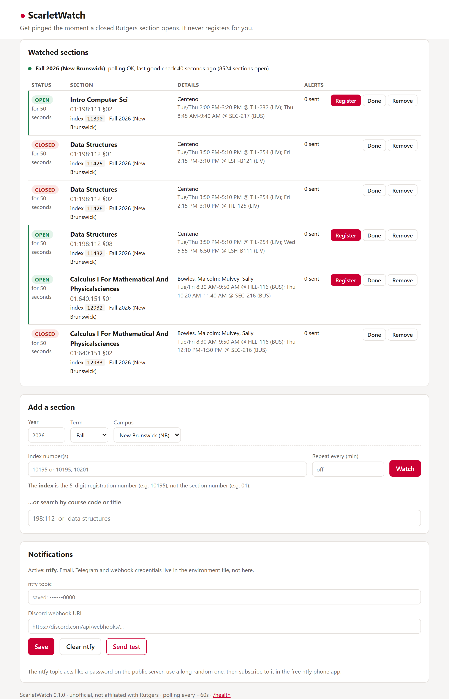
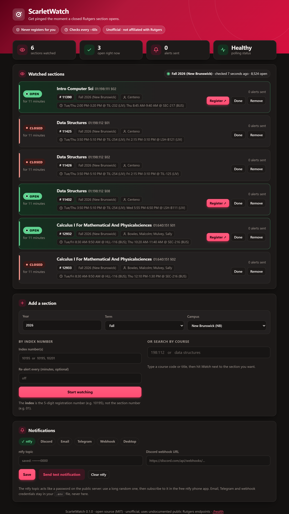
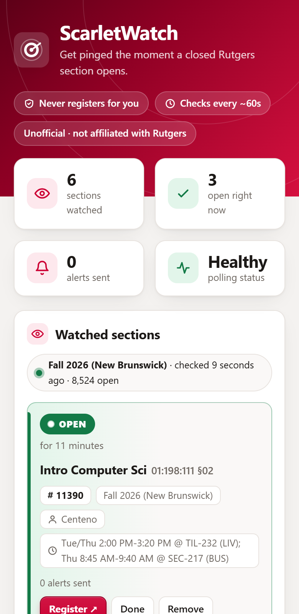

# ScarletWatch

Get a phone notification the moment a **closed** Rutgers course section **opens**.

ScarletWatch is a small, self-hosted tool. You tell it which sections (by index number) you want, it checks the public Schedule of Classes data about once a minute, and it pings you (free, via ntfy, Discord or email) when a section flips from closed to open. You tap the link in the notification, log in to WebReg yourself, and register.



> **It does not, and will not, register for you.** There is no login to any Rutgers system, no NetID, no password, no CAS or Duo handling, and nothing like that is ever stored. It only reads two public JSON files and tells *you*.

## Disclaimers

- **Unofficial.** ScarletWatch is an independent open-source project. It is **not affiliated with, endorsed by, or supported by Rutgers, The State University of New Jersey.**
- It uses **undocumented public endpoints** of the Schedule of Classes (`classes.rutgers.edu/soc/api/...`). They can change or disappear without notice, and then this tool will stop working until it is updated.
- You are responsible for how you use it. **Read Rutgers' acceptable-use policy**, [Policy 70.1.1, Acceptable Use Policy for Information Technology Resources](https://sca.rutgers.edu/sites/default/files/pdf/70-1-1-current.pdf) (the authoritative, current version is in the [Rutgers Policy Library](https://policies.rutgers.edu/)), and keep to it. See also the [polite-use policy](#polite-use-policy) below.
- No warranty (see [LICENSE](LICENSE)). A notification can be late or missed (network trouble, your phone, Rutgers' data lagging). Don't rely on it as your only plan.

## Quick start (about 5 minutes)

You need Python 3.11 or newer. ntfy is the recommended notifier because it needs **no account**.

**1. Install**

```bash
git clone https://github.com/nithin-sai-ega/scarletwatch.git
cd scarletwatch
pip install .          # or: uv run snipe --help
```

**2. Set up phone notifications with ntfy (free)**

1. Install the free **ntfy** app ([Android](https://play.google.com/store/apps/details?id=io.heckel.ntfy) / [iPhone](https://apps.apple.com/us/app/ntfy/id1625396347)).
2. Make up a **long random topic name**. On the public ntfy.sh server the topic name *is* the password: anyone who guesses it can read your alerts or send you fake ones. Generate one:

   ```bash
   python -c "import secrets; print('rutgers-' + secrets.token_urlsafe(16))"
   ```
3. In the app, tap **+** and subscribe to that topic.
4. Copy `.env.example` to `.env` and set `SCARLETWATCH_NTFY_TOPIC=<your topic>`. (You can also paste the topic into the dashboard later.) Run `snipe` from this folder so it finds `.env` and keeps its data in `./data`.
5. Check it works:

   ```bash
   snipe test-notify
   ```
   Your phone should buzz.

**3. Find your section's index number**

The **index** is the 5-digit *registration number* (for example `10195`). It is **not** the section number (`01`). Search for it:

```bash
snipe search "198:112" --year 2026 --term fall        # by course code
snipe search "data structures" --semester "fall 2026 NB"   # by title
```

**4. Watch it**

```bash
snipe add 11425 11426 --year 2026 --term fall --campus NB
snipe run
```

Open **http://127.0.0.1:8000/** for the dashboard. Leave `snipe run` going (see [running it all the time](#running-it-all-the-time)).

When a watched section opens you get a notification with the course, section, index, instructor, meeting times, how long ago it opened, and a **Register** link. Tap it, log in yourself, and register fast.

**Verify the Register link once.** The default link is
`https://sims.rutgers.edu/webreg/editSchedule.htm?login=cas&semesterSelection=92026&indexList=12345`.
This is the same link format the Schedule of Classes site itself builds for its "Register" button, but it can't be tested without logging in. Open one such link yourself once to confirm it still lands where you expect. If it ever breaks, change `SCARLETWATCH_REGISTER_URL_TEMPLATE` (or set it empty to fall back to `https://sims.rutgers.edu/webreg/`).

## The dashboard

<p>
  
  
</p>

The dashboard follows your system's light/dark setting and works on a phone.

- Live status badges (open / closed), how long it has been in that state, last good check and poll health per semester.
- **Add a section** by index (paste several: `10195, 10201`) or search by course code/title and click **Watch**.
- **Remove**, or mark **Done** (kept in the list but no longer polled).
- A **Notifications** box for your ntfy topic or Discord webhook, with a **Send test notification** button.
- It binds to `127.0.0.1` and has **no login**, so don't expose it to the internet (see below). Email, Telegram and webhook credentials are never entered or stored in the UI; they stay in your environment file.

## CLI reference

| Command | What it does |
|---|---|
| `snipe add INDEX... --year 2026 --term fall --campus NB` | Watch sections (validated against the catalog). `--repeat N` re-notifies every N minutes while open. `--force` skips validation. |
| `snipe remove INDEX...` / `snipe done INDEX...` | Delete a watch / keep it but stop polling it. Add `--semester` if the index is watched in several semesters. |
| `snipe list` | List watches. |
| `snipe status` | Statuses, how long each has been open/closed, last opening duration, poll health. |
| `snipe search "198:112" --year 2026 --term fall` | Find index numbers by course code (`198:112`, `01:198:112`, `198`) or title. |
| `snipe run` | Poll and serve the dashboard. `--no-web` polls only; `--host`, `--port` override the bind address. |
| `snipe test-notify` | Send a test through every configured notifier. `--preview INDEX --semester ...` sends a labelled sample of a real alert. |

Everywhere a semester is needed you can write `--year 2026 --term fall --campus NB`, or `--semester "fall 2026 New Brunswick"`.

## How semesters work

A semester is three things: **year**, **term**, **campus**.

| Term | Code | Notes |
|---|---|---|
| Winter | `0` | January session, labelled with the *new* year |
| Spring | `1` | |
| Summer | `7` | |
| Fall | `9` | |

| Campus | Code |
|---|---|
| New Brunswick | `NB` |
| Newark | `NK` |
| Camden | `CM` |

You can say `fall`, `New Brunswick`, etc., or use the raw codes (`--term 9 --campus NB`). Raw campus codes other than the three above (for example `ONLINE_NB`) are passed through as-is; the server decides whether it has data.

The WebReg link needs `semesterSelection` = term digit + year (Fall 2026 → `92026`). ScarletWatch builds that for you.

Good to know:

- You can watch sections from several semesters at once. Each (year, term, campus) is polled with **one** request per cycle, however many sections you watch in it. Semesters with no active watches are not polled.
- Before registration opens for a term, the data may show nearly everything as "open". That does not mean you can register yet.
- There is no server-side "level" filter (undergrad/grad); the search just shows everything.

## Configuration reference

Set these as environment variables or in a `.env` file in the directory you run from (see [.env.example](.env.example)). Names are prefixed `SCARLETWATCH_`.

| Variable | Default | Meaning |
|---|---|---|
| `POLL_INTERVAL` | `60` | Seconds between checks. **Minimum 30**, enforced in code. Small random jitter is added. |
| `DATA_DIR` | `./data` | SQLite database and catalog cache. |
| `CATALOG_TTL_MINUTES` | `60` | How long the course catalog is cached (minimum 15). |
| `HOST` / `PORT` | `127.0.0.1` / `8000` | Dashboard bind address. |
| `REGISTER_URL_TEMPLATE` | WebReg link | Placeholders: `{semester}` `{term}` `{year}` `{campus}` `{index}` `{indexes}`. Empty = WebReg home page. |
| `NTFY_TOPIC`, `NTFY_SERVER`, `NTFY_TOKEN` | – / `https://ntfy.sh` / – | ntfy. Token only for protected/self-hosted servers. |
| `DISCORD_WEBHOOK_URL` | – | Discord webhook. |
| `SMTP_HOST`, `SMTP_PORT`, `SMTP_USERNAME`, `SMTP_PASSWORD`, `SMTP_FROM`, `SMTP_TO`, `SMTP_SECURITY` | – / 587 / … / `starttls` | Email. `SMTP_SECURITY` is `starttls`, `ssl` or `none`. `SMTP_TO` may be comma-separated. |
| `TELEGRAM_BOT_TOKEN`, `TELEGRAM_CHAT_ID` | – | Telegram bot. |
| `WEBHOOK_URL` | – | Generic webhook: receives a JSON `POST` (`event`, `title`, `message`, `link`, `data`). |
| `DESKTOP_NOTIFICATIONS` | `false` | Desktop pop-ups. **Only useful on the machine you are sitting at**; useless on a server or Pi. |
| `LOG_LEVEL`, `LOG_FORMAT` | `INFO`, `text` | `LOG_FORMAT=json` for structured logs. |

A topic or webhook saved in the dashboard overrides the same setting from the environment.

### Notifiers

Each notifier is independent: if one fails, the others still fire. Secrets are never written to logs.

- **ntfy** (recommended): free phone push, no account. Use a long random topic. For privacy you can self-host ntfy and set `NTFY_SERVER`.
- **Discord webhook**: Server settings → Integrations → Webhooks → New webhook → copy URL.
- **Email (SMTP)**: for Gmail, turn on 2-step verification and create an **app password**; use `smtp.gmail.com`, port `587`, `starttls`. Good as a backup channel.
- **Telegram**: create a bot with @BotFather, message it once, and find your chat id. Set the token and chat id.
- **Generic webhook**: for Home Assistant, n8n, your own script, etc.
- **Desktop**: only when running on your own computer.

Adding another notifier is one small class implementing `Notifier.send` in `src/scarletwatch/notifiers/`.

## Check that notifications work

**You never give ScarletWatch a phone number.** There is no SMS. Phone alerts come from the free ntfy app (no account, no number), and email, if you want it, is sent through *your own* mail account using an app password that stays in your local `.env` file. Nothing is sent to the project author or any ScarletWatch server; there isn't one.

1. **Basic test.** `snipe test-notify` (or the **Send test notification** button in the dashboard) sends a harmless test through every configured channel and prints one line per channel: `sent`, or `FAILED - <reason>`. A failure in one channel never blocks the others.
2. **Preview a real alert.** This sends a clearly labelled **SAMPLE** of the actual alert (course, section, instructor, times, Register link) for a real section, without changing any watch:

   ```bash
   snipe test-notify --preview 11425 --semester "fall 2026 NB"
   ```
   Tap the Register link on your phone to confirm it opens WebReg (you log in yourself).
3. **Email (optional).** Set `SCARLETWATCH_SMTP_HOST`, `SMTP_USERNAME`, `SMTP_PASSWORD` (a Gmail *app password*, not your real password), `SMTP_FROM` and `SMTP_TO` in `.env`, then run `snipe test-notify`. Check spam the first time.
4. **Do a live dry run.** Add a section that is currently closed, run `snipe run`, and leave it. The alert fires on its own when someone drops the class. For a quick end-to-end check with no waiting, steps 1 and 2 are the closest thing; they use the exact same delivery code as a real alert.

If nothing arrives: confirm the topic is spelled identically in the app and in `.env`, that the ntfy app is allowed to notify you (and not battery-optimized), and look at the `FAILED` message.

## Running it all the time

ScarletWatch only works while it is running, so run it on something that stays on.

### Always-on PC or laptop

Leave a terminal open with `snipe run`, or on Windows create a Task Scheduler task ("At log on") running `snipe run` from the project folder. Make sure the machine does not sleep. For phone alerts use ntfy; desktop pop-ups only help if you are at that machine.

### Docker

```bash
cp .env.example .env     # edit it
docker compose up -d
```

The compose file stores data in a named volume and publishes the dashboard on `127.0.0.1:8000` only. Leave `SCARLETWATCH_HOST` and `SCARLETWATCH_DATA_DIR` commented out in `.env` (as they are in `.env.example`); the image sets them. The image builds from the multi-arch `python:3.12-slim` base, so it should also build on a 64-bit Raspberry Pi. Add watches with `docker compose exec scarletwatch snipe add 11425 --year 2026 --term fall` or in the dashboard.

### Raspberry Pi or a VPS (systemd)

```bash
sudo useradd --system --home /var/lib/scarletwatch scarletwatch
sudo git clone https://github.com/nithin-sai-ega/scarletwatch.git /opt/scarletwatch
cd /opt/scarletwatch
sudo python3 -m venv .venv && sudo .venv/bin/pip install .
sudo cp .env.example /etc/scarletwatch.env && sudo chmod 600 /etc/scarletwatch.env   # edit it
sudo cp deploy/scarletwatch.service /etc/systemd/system/
sudo systemctl daemon-reload && sudo systemctl enable --now scarletwatch
journalctl -u scarletwatch -f
```

Data lives in `/var/lib/scarletwatch`; as with Docker, leave `SCARLETWATCH_DATA_DIR` commented out in `/etc/scarletwatch.env`. The unit runs as an unprivileged user in a tight sandbox (`systemd-analyze security scarletwatch` rates it 1.3, "OK"). Raspberry Pi OS (bookworm) ships Python 3.11, which is enough.

To use the dashboard on a remote machine, **don't** open the port to the internet. Use an SSH tunnel (`ssh -L 8000:127.0.0.1:8000 you@server`) or a VPN such as Tailscale. The dashboard has no login: anyone who can reach it can change your watches.

## Polite-use policy

ScarletWatch is built to be a good citizen, and you should keep it that way:

- **One request per (year, term, campus) per cycle**, no matter how many sections you watch.
- Default interval 60 s with jitter; **never faster than 30 s** (the server caches for 30 s, so faster is pointless). Don't edit the code to go faster.
- The large course catalog (about 1 MB gzipped) is cached on disk and refreshed lazily (at most about once an hour), never per poll.
- Descriptive `User-Agent` (`course-snipe/<version> (+repo URL)`), no personal info.
- Exponential backoff on timeouts, HTTP 429 and 5xx, honoring `Retry-After`.
- Responses are gzip-compressed (about 20 KB per poll). Conditional requests (`If-None-Match`) are not used because the server returned a different ETag on every response in testing, so they could not save anything.
- Suspicious data (empty list, malformed JSON, a sudden large drop in size) is logged and skipped. It never counts as "everything closed", so a glitch cannot trigger false alarms.
- One install per person. Don't run it as a shared service for many users.

## How it works

1. Every cycle it fetches `openSections.json` for each active semester: a list of every open index. A section is open if and only if its index is in the list.
2. For each watch it runs a small state machine: it notifies **exactly once** on each closed → open transition. If a section is already open when you add it, you are told right then ("already open") and no alert is pushed. Open → closed transitions are recorded, so the dashboard can say "was open for 4 minutes".
3. If a notification cannot be delivered anywhere, it is retried on the following polls (up to 10 times) instead of being lost.
4. If a watched index disappears from the course catalog, you get a one-time warning.
5. Friendly details (title, instructor, times) come from the cached `courses.json`.

Optional: `--repeat N` (or "Re-alert every" in the dashboard) re-sends the alert every N minutes while a section stays open. It is off by default.

## Development

```bash
python -m venv .venv && . .venv/bin/activate     # Windows: .venv\Scripts\activate
pip install -e ".[dev]"
ruff check . && ruff format --check . && mypy && pytest
```

Tests never touch the live API; they use small recorded fixtures in `tests/fixtures/` and mocked HTTP. CI runs lint, type checks and tests on Python 3.11, 3.12 and 3.13.

```
src/scarletwatch/
  semesters.py   term/campus parsing        rutgers.py   HTTP client, backoff
  guards.py      bad-data checks            catalog.py   catalog cache, search
  machine.py     state machine (pure)       engine.py    applies a poll to watches
  store.py       SQLite                     service.py   scheduler, alerts
  notifiers/     ntfy, discord, smtp, ...   web/         FastAPI + HTMX dashboard
  cli.py         the `snipe` command
```

## Troubleshooting

- **No notification arrives**: run `snipe test-notify`. Check the topic matches in the app, and that your phone allows ntfy notifications (disable battery optimization for it on Android).
- **"Index ... does not exist"**: check year, term and campus; use `snipe search` to find the right index.
- **"suspicious data: empty list"** in the logs: usually a wrong term/campus (Rutgers answers `[]`), or a brief server glitch. It is skipped and retried.
- **Dashboard shows "no longer in the course catalog"**: the section was likely cancelled or renumbered; find the new index.

## License and credits

MIT, copyright (c) 2026 Nithin Sai Ega. See [LICENSE](LICENSE).

The dashboard bundles [htmx](https://htmx.org) 2.0.4 (`src/scarletwatch/web/static/htmx.min.js`), licensed under the Zero-Clause BSD license.
